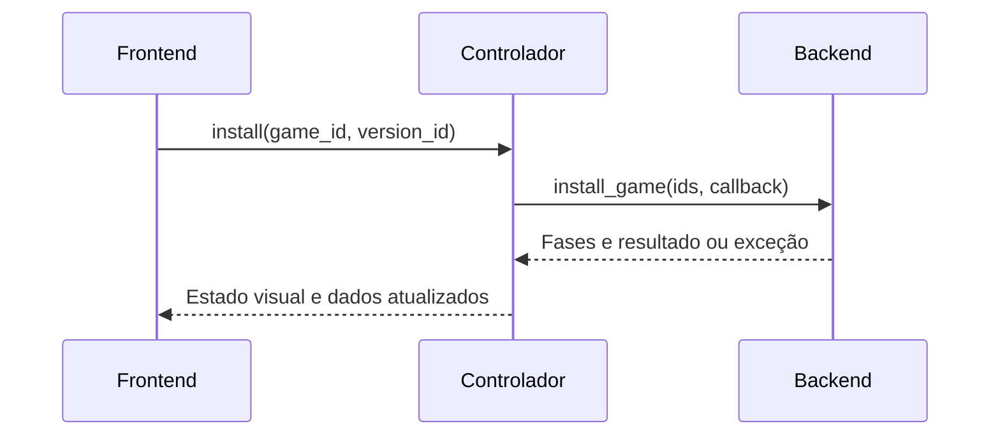

# Arquitetura

A separação é de responsabilidades e dependências de código. O launcher permanece um aplicativo desktop, com as camadas executando no mesmo processo. Não foi introduzido um servidor web.

## Limites das camadas

| Camada | Pode importar | Não deve fazer |
| --- | --- | --- |
| `frontend` | Seus próprios módulos, `contracts`, CustomTkinter, Tkinter e Pillow. | Consultar SQLite, decidir regras de instalação, baixar arquivos ou iniciar processos. |
| `backend` | Seus próprios módulos, `contracts`, biblioteca padrão e dependências de download/extração. | Conhecer janelas, botões, navegação, temporizadores Tk ou importar o frontend. |
| `application` | Seus próprios módulos, `contracts` e biblioteca padrão. | Construir widgets, executar SQL ou importar implementações concretas do frontend/backend. |
| `contracts` | Biblioteca padrão. | Executar operações de GUI, rede, disco ou persistência. |
| `main.py` | As implementações concretas das camadas. | Conter regras de negócio ou definir o layout das telas. |

Essas regras são verificadas por `tests/test_architecture.py`.

## Fluxo de uma instalação

O callback de progresso recebe somente `Phase`. O backend nunca recebe o botão que iniciou a operação. A instalação é síncrona do ponto de vista da API; o controlador decide executá-la em uma tarefa em segundo plano.

O worker coloca os callbacks em uma fila. O frontend chama `controller.poll()` pelo temporizador da janela, e o controlador entrega os resultados na thread principal. Workers não chamam `after()`, `configure()` ou outro método de widget.

## Contratos públicos

`contracts/models.py` define dados imutáveis:

- `GameSummary`: informações do jogo, estado de instalação, ação disponível, capa e pontuação.
- `GameDetails`: dados do jogo, banner e versões.
- `VersionInfo`: informações e disponibilidade de uma versão.
- `PlatformInfo`: jogos, banner, exemplos de catálogo e emulador da plataforma.
- `OperationStatus`: alvo, operação, fase e eventual erro.
- `InstallationResult`: jogo, versão e caminho instalado.
- `UiResources`: localização dos ícones estáticos usados pela interface.

`LibraryFilter`, `GameAction` e `Phase` são valores semânticos. O backend conhece filtros como `INSTALLED` e `FAVORITES`; o controlador traduz as rotas visuais, como `biblioteca`, para esses filtros.

`contracts/ports.py` define três protocolos:

- `Backend`: operações e consultas disponíveis para qualquer cliente.
- `Actions`: eventos que uma interface pode emitir.
- `View`: operações de apresentação chamadas pelo controlador.

Objetos `sqlite3.Row`, repositórios e conexões ficam dentro do backend. A interface recebe dataclasses e envia identificadores simples.

## Backend

O ponto de entrada recomendado é `backend/api.py`, classe `LauncherService`.

| Diretório/módulo | Conteúdo |
| --- | --- |
| `database/` | Conexões, esquema e migrações idempotentes. |
| `library/` | Jogos, versões, plataformas, coleções e repositórios. |
| `download/` | Transporte, extração e instalação de jogos. |
| `assets/` | Registro de recursos, download, cache portátil e caminhos de fallback. |
| `launchers/` | Execução nativa/web e execução de ROMs via plugin. |
| `emulators/` | Pacotes, instalação e estado dos emuladores. |
| `plugins/`, `plugin_adapters/` | Carregamento de plugins e adaptador PCSX2. |
| `catalog/platforms.json` | Nomes e exemplos de jogos das antigas telas de plataformas. |
| `score.py`, `services/` | Pontuações persistentes e tempo jogado. |
| `path_resolver.py` | Política central de caminhos. |
| `tools/` | Ferramentas administrativas de terminal. |
| `__main__.py` | Cliente CLI da API, sem dependência da interface gráfica. |

Cada chamada da fachada usa `database_scope()` e fecha as conexões que criou. Não são compartilhadas conexões SQLite entre a thread principal e os workers. O acompanhamento de tempo de um processo também abre suas conexões na própria thread.

A API propaga falhas de operação ao chamador. Falhas de assets são recuperáveis e retornam um placeholder existente, com registro no log.

## Frontend

| Arquivo | Alteração típica |
| --- | --- |
| `theme.py` | Cores, dimensões dos cards e tamanho das capas. |
| `components.py` | Sidebar, agrupamentos e componentes compartilhados. |
| `cards.py` | Layout do card e menus visuais. |
| `images.py` | Dimensionamento, recorte e efeitos das imagens. |
| `bindings.py` | Estado temporário dos controles e rótulos de pontuação. |
| `views/catalog.py` | Grades e busca. |
| `views/details.py` | Detalhes e versões. |
| `views/platform.py` | Template visual reutilizado pelas plataformas. |
| `views/settings.py` | Tela de configurações. |
| `window.py` | Janela, ciclo de vida, apresentação das telas e temporizador de polling. |
| `preview.py` | Fixtures e navegação para trabalhar no visual sem o backend. |

Importar `frontend.window` não abre uma janela. A janela só é criada ao instanciar `LauncherWindow`.

## Como alterar sem misturar responsabilidades

Para mudar cores, espaçamentos ou a disposição dos botões, altere somente o frontend. Para mudar transporte, instalação, seleção de executáveis ou consultas, altere somente o backend, mantendo os contratos públicos.

Uma funcionalidade com novos dados ou uma nova ação exige atualizar o contrato e os adaptadores envolvidos. A separação reduz acoplamentos internos; ela não elimina a necessidade de compatibilidade no contrato de comunicação.

A prévia visual serve para testar apresentação com fixtures. A CLI serve para exercitar operações reais do backend. A suíte automatizada verifica as duas camadas separadamente e também a integração entre elas.
